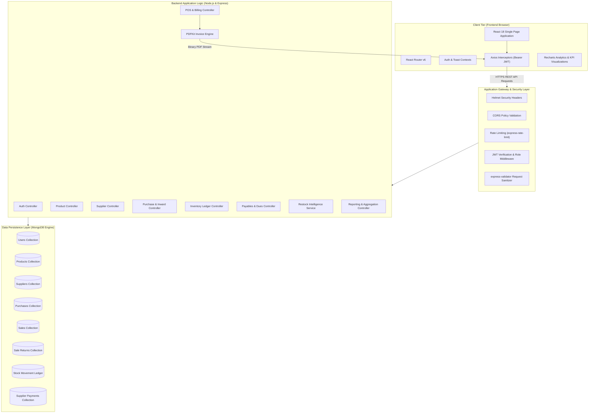
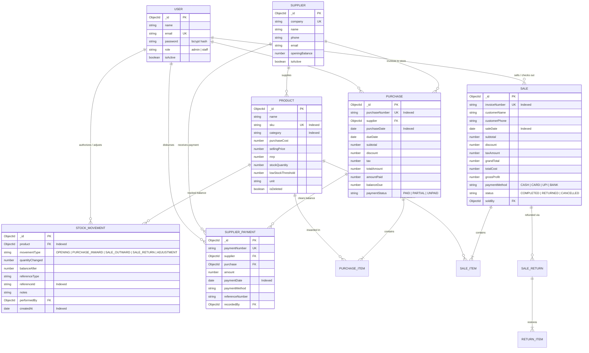

# StockWise — Architecture & Database Design

## 1. System Architecture Overview

StockWise is designed using a decoupled, multi-tier Client-Server architecture optimized for reliability, high responsiveness, and strict data consistency in retail environments.

---

## 2. Entity-Relationship (ER) Diagram

---

## 3. Data Integrity & Concurrency Safeguards

1. **Atomic Stock Decrement**: POS checkouts issue conditional queries `{ _id: productId, stockQuantity: { $gte: qty } }` with `$inc: { stockQuantity: -qty }`. Transactions that exceed available inventory fail immediately without negative stock anomalies.
2. **Compensation Rollback**: If a multi-item cart encounters a stock exhaustion on item $N$, previous items $(1 \dots N-1)$ that were deducted in that request are atomically restored.
3. **Idempotency Keys**: Both purchases and sales accept unique idempotency keys to prevent duplicate checkout submissions or double inward movements upon client retry.
4. **Soft Deletion**: Products with historical sales or purchases are archived (`isDeleted = true`) rather than dropped, preserving historical invoices and audit logs.
